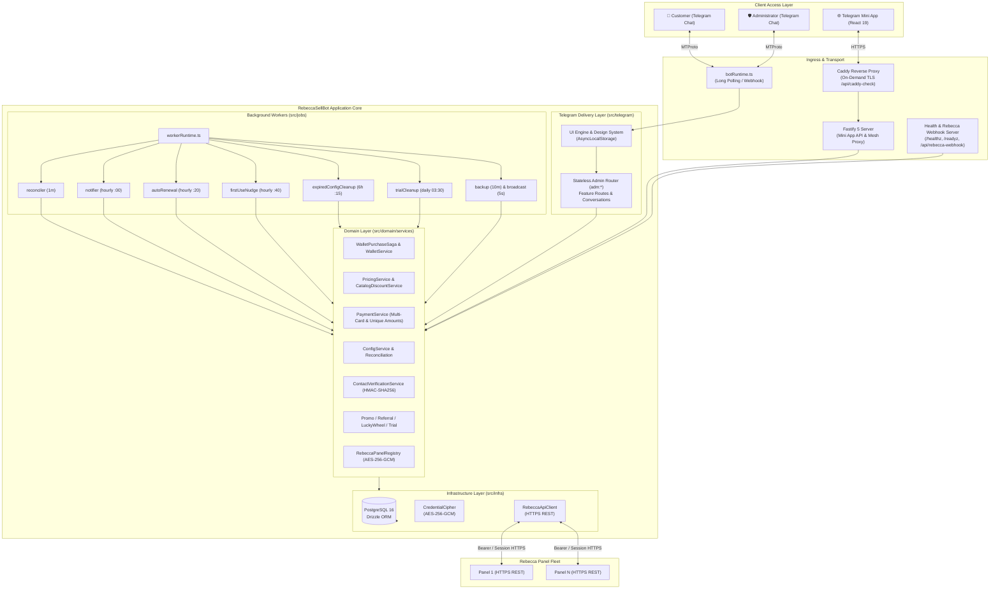

# RebeccaSellBot — System Architecture

RebeccaSellBot is a multi-panel Telegram commerce and subscription management platform built for **Rebecca Panel** VPN infrastructures. It combines a clean-chat Telegram bot (`grammY`), an optional Telegram Mini App (`Fastify 5` + `React 19`), a 3-phase financial saga engine, and automated lifecycle workers backed by **PostgreSQL 16** (`Drizzle ORM`).

---

## 1. High-Level Topology



### Architectural Invariants

1. **Zero Database Touch on Rebecca Panels:** All remote provisioning, quota queries, lifecycle transitions (`active`, `on_hold`, `disabled`, `limited`, `expired`), and subscription link rotations occur strictly over HTTPS REST (`RebeccaApiClient`).
2. **Strict Layer Isolation (Enforced by `scripts/check-architecture.mjs`):**
   - `src/telegram/*` never imports `src/infra/db.ts`, `src/infra/schema.ts`, or `RebeccaApiClient`, nor calls `panelRegistry.getService()` directly.
   - `src/domain/*` is pure business logic and never imports `grammy` or `src/telegram/*`.
   - `src/infra/*` encapsulates database connections, migrations, cryptography, and HTTP clients.
3. **Dual-Mode Delivery:** Runs in outbound Long Polling mode by default (zero open ports). Switching to Webhook mode enables `X-Telegram-Bot-Api-Secret-Token` verification; switching back to polling automatically clears registered webhooks.

---

## 2. Financial Engine & Security

### Minor-Unit Integer Arithmetic (`DbNumber.ts`)

All monetary balances, package prices, discounts, referral bonuses, and ledger entries are stored and calculated as **signed 64-bit safe integers** (`-9,007,199,254,740,991` to `9,007,199,254,740,991`) in minor currency units (Tomans). PostgreSQL check constraints enforce `balance >= reserved_balance` and `reserved_balance >= 0` at all times.

### 3-Phase Purchase & Renewal Saga (`WalletPurchaseSaga.ts`)

```text
1. RESERVE (Local DB Tx)
   ├── Lock user row, verify available balance (balance - reserved_balance >= amount)
   ├── Snapshot checkout price, catalog discount, promo reservation, & referral terms
   └── Create `purchase_intents` row (status = 'pending') with foreground heartbeat lease

2. DISPATCH (Remote HTTPS REST)
   ├── Provision new user or renew existing user on target Rebecca panel
   └── Apply `on_hold` start-on-first-use or renewal quota/validity rollover policies

3a. COMMIT (On Confirmed Remote State)
   ├── Deduct balance & release reservation, write immutable `wallet_transactions` row
   ├── Upsert `user_configs`, settle referral bonus / cashback, & mark checkout completed
   └── Deliver subscription artifact (sub link, QR code, client deep-links)

3b. COMPENSATE (On Definitive Remote Failure)
   ├── Release reserved funds & promo code redemption cap
   └── Mark intent `'failed'` with diagnostic audit metadata
```

If a process crashes or a network timeout occurs during Phase 2, the intent transitions to `'reconciliation_required'` and the background `reconciler` settles it once the foreground lease (`leaseExpiresAt`) expires by inspecting remote panel state.

### Receipt Security, Payment Void & Multi-Card Rotation

- **Duplicate Receipt Fingerprinting (`WalletService`):** Top-up receipts record both Telegram's `file_unique_id` (`fileUniqueId`) and the downloaded media's `SHA-256` digest (`fileSha256`). Depending on `receipt_duplicate_policy`:
  - `'warn'` (default): Accepts the submission, links `duplicateOfReceiptId`, and displays a duplicate warning banner across admin Telegram alerts, receipt review queues, and WebApp `/api/admin/receipts`.
  - `'block'`: Rejects duplicate receipt submissions immediately with `DuplicateReceiptError`.
- **Atomic Approved-Receipt Voiding (`WalletService.voidApprovedTopup`):**
  - Locks the receipt (`FOR UPDATE`) and verifies `status === 'approved'`.
  - Deducts up to the user's available free balance (`balance - reserved_balance`), writes an idempotent `wallet_transactions` row (`type: 'topup_void'`, `referenceId: void_${receiptId}`), and marks the receipt `'voided'` (`voidedAt`, `voidedBy`, `voidReason`).
  - If the user already spent part of the top-up and `disablePurchasedConfigs` is enabled, automatically disables active configs purchased after the receipt on the remote Rebecca panel (`ConfigService.disableConfig`), records `audit_logs`, and notifies the user.
- **Multi-Card Pool & Unique Payable Amounts (`PaymentService`):**
  - Supports a JSON pool of bank cards (`bank_cards_json`: `{ id, cardNumber, cardHolder, enabled, dailyCapToman }`) with automatic daily-cap tracking and rotation (`selectCardForTopup`), falling back seamlessly to `card_number` / `card_holder`.
  - `allocateUniquePayableAmount` generates collision-free payable amounts against recent `pending` receipts.

---

## 3. Storefront, Flash Sales & Privacy-Preserving Auth

### Timed Catalog Discounts (`CatalogDiscountService.ts` & `PricingService.ts`)

- Manages scheduled flash sales in `catalog_discounts` scoped to `'all'`, `'category'`, or `'package'` with `'percent'` or `'fixed'` reductions, optional `maxDiscountAmount` ceilings, and `startsAt` / `expiresAt` windows.
- `PricingService` resolves the highest-savings active discount for both fixed packages and custom-volume quotes, returning `originalPrice`, `effectivePrice`, `activeDiscountTitle`, and `discountExpiresAt` across Telegram menus, checkout screens, and WebApp endpoints (`/api/user/packages`, `/api/user/quote`, `/api/user/checkout`).
- Administrators can edit individual discount fields (`CatalogDiscountService.updateDiscount`) and launch confirmed broadcast announcements directly from the discount detail screen (`adm:dsc:*`).

### HMAC-SHA256 Phone Verification (`ContactVerificationService.ts`)

- **Zero Raw Phone Persistence:** Normalizes shared Telegram contact numbers, enforces optional Iranian `+98` prefix validation (`phone_verify_iran_only`, default `true`), and computes an `HMAC-SHA256` digest using a domain-separated key derived from `BOT_TOKEN`.
- Only `phoneHash` (enforced unique via partial index `users_phone_hash_unique`) and `phoneVerifiedAt` are stored in `users`.
- Configurable verification gates protect free trials (`require_phone_for_trial`) and paid checkouts (`require_phone_for_purchase`) across both Telegram (`verifyPhoneConversation` verifying `contact.user_id === ctx.from.id`) and WebApp (`403 PHONE_VERIFICATION_REQUIRED`).

### Rebecca Lifecycle & Service Customization

- **Start-on-First-Use (`on_hold_default_enabled`):** Provisions new subscriptions in Rebecca's `on_hold` status so duration countdown begins on first connection.
- **Renewal Rollover (`renewal_rollover_enabled`):** Preserves remaining data quota and remaining validity when renewing an active subscription.
- **Custom Service Names (`custom_service_name_enabled`):** Allows buyers to specify an English service label (`3–20` chars, `[a-z0-9_]`) verified for uniqueness before checkout.
- **Client Deep-Links & Sub Rotation:** Renders 1-tap import links (Happ, v2rayNG, Streisand, Hiddify, Sing-box/Clash) and allows users to rotate compromised subscription URLs (`ConfigService.revokeSubscription`).

---

## 4. Background Workers (`src/jobs/`)

All background jobs run under `src/jobs/workerRuntime.ts` (`jobRunner`), which prevents overlapping runs of the same job and drains active executions gracefully on `SIGINT` / `SIGTERM` (30s timeout).

| Worker                     | Schedule       | Responsibility                                                                                                                                                                                                                                                                                                                                                                      |
| :------------------------- | :------------- | :---------------------------------------------------------------------------------------------------------------------------------------------------------------------------------------------------------------------------------------------------------------------------------------------------------------------------------------------------------------------------------- |
| **`reconciler`**           | Every `1m`     | Settles non-terminal `purchase_intents`, `refund_intents`, `trial_claims`, and expired `purchase_checkouts`; syncs panel statuses and scans orphaned configs every 15m.                                                                                                                                                                                                             |
| **`notifier`**             | `0 * * * *`    | Hourly sweep for low traffic (`low_traffic_threshold_gb`) and near expiry (`expiry_warning_days`) with durable deduplication in `notification_deliveries`.                                                                                                                                                                                                                          |
| **`autoRenewal`**          | `20 * * * *`   | Hourly evaluation of subscriptions with `autoRenewEnabled = true`, executing wallet-backed renewal sagas within the user's approved price ceiling (`autoRenewPrice`).                                                                                                                                                                                                               |
| **`firstUseNudge`**        | `40 * * * *`   | Hourly scan for configs created 24–72h ago (`firstUseCheckedAt IS NULL`) with zero live panel traffic (`used_traffic === 0 && lifetime_used_traffic === 0`); atomically marks `firstUseCheckedAt` and sends a localized connection guide.                                                                                                                                           |
| **`expiredConfigCleanup`** | `15 */6 * * *` | Staged cleanup of expired configs when `expired_cleanup_enabled = true`. Anchors deadline to `max(panelExpire, expired_cleanup_enabled_at, cleanupHoldUntil) + graceDays`, verifies live panel state via `getUser` before every action, sends deduplicated first/last warnings (`expired_cleanup_warn_days`, default `3,1`), deletes unrenewed configs, and writes to `audit_logs`. |
| **`trialCleanup`**         | `30 3 * * *`   | Daily sweep (03:30 UTC) removing expired free-trial configs past their grace window.                                                                                                                                                                                                                                                                                                |
| **`backup`**               | `*/10 * * * *` | Checks every 10m whether `backup_interval_hours` has elapsed and dispatches compressed snapshots to `backup_target_chat_id`.                                                                                                                                                                                                                                                        |
| **`broadcast`**            | `5s` loop      | Claims batches of 15 recipients (`broadcast_recipients`) with concurrency 3, respecting Telegram rate limits and live cancellation.                                                                                                                                                                                                                                                 |

---

## 5. Telegram Mini App & Multi-Instance Mesh

```text
Public HTTPS (*.yourdomain.com)
       │
       ▼
┌────────────────────────┐
│     Caddy Ingress      │ ── ask ──► GET http://main_bot:3002/api/caddy-check?domain=<host>
└───────────┬────────────┘
            │ reverse_proxy main_bot:3002
            ▼
┌────────────────────────┐
│   main_bot (Fastify)   │ ── Host matches peer in /app/data/registry/*.json?
└───────────┬────────────┘
     ┌──────┴──────┐
   Local         Peer Instance
     ▼             ▼
 Serve Local    Proxy over `rsbot_mesh` (loop-guarded via `x-rsbot-proxy-hops`)
```

- **Backend (`src/webapp/server/`):** Fastify 5 server validating Telegram WebApp `initData` (`HMAC-SHA256`), issuing HTTP-only admin JWT cookies (`ADMIN_SESSION_SECRET`), enforcing per-route rate limits, and serving `/api/user/*` and `/api/admin/*`.
- **Frontend (`webapp/src/`):** React 19 + Tailwind CSS v4 + DaisyUI v5 + TanStack Query SPA providing customer subscription/shop views and a full admin dashboard (stats, receipt review/voiding, user management, packages, panels).

---

## 6. Database Schema Overview (`src/infra/schema.ts`)

PostgreSQL 16 schema managed via Drizzle ORM (`drizzle/0000_*.sql` through `drizzle/0011_*.sql`) plus idempotent startup guards in `src/infra/migrate.ts`:

| Category                | Tables                                                                                                                                                               |
| :---------------------- | :------------------------------------------------------------------------------------------------------------------------------------------------------------------- |
| **Panels & Fleet**      | `rebecca_panels` (AES-256-GCM credentials), `rebecca_panel_services`, `config_counters`                                                                              |
| **Users & Auth**        | `users` (balances, CRM stats, `phone_hash`, `phone_verified_at`), `bot_admins`, `grammy_sessions`                                                                    |
| **Wallet & Receipts**   | `wallet_transactions` (`topup`, `topup_void`, `purchase`, `refund`, etc.), `topup_receipts` (`file_unique_id`, `file_sha256`, `duplicate_of_receipt_id`, `voided_*`) |
| **Commerce & Sagas**    | `purchase_checkouts`, `purchase_intents`, `refund_intents`, `trial_claims`, `package_categories`, `catalog_discounts`                                                |
| **Subscriptions & Ops** | `user_configs` (`panel_*` cache, `first_use_checked_at`, `cleanup_hold_until`), `config_reconciliation_issues`, `notification_deliveries`                            |
| **Growth & Audit**      | `promo_codes`, `code_redemptions`, `lucky_wheel_spins`, `broadcast_jobs`, `broadcast_recipients`, `settings`, `audit_logs`                                           |
