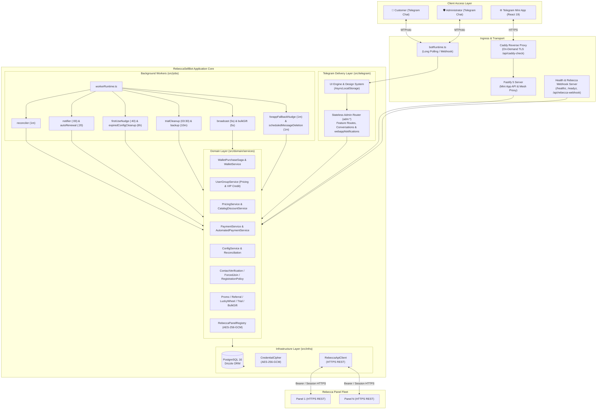

# RebeccaSellBot — System Architecture

RebeccaSellBot is a multi-panel Telegram commerce and subscription management platform built for **Rebecca Panel** VPN infrastructures. It combines a clean-chat Telegram bot (`grammY`), an optional Telegram Mini App (`Fastify 5` + `React 19`), a 3-phase financial saga engine, and automated lifecycle workers backed by **PostgreSQL 16** (`Drizzle ORM`).

---

## 1. High-Level Topology



### Architectural Invariants

1. **Zero Database Touch on Rebecca Panels:** All remote provisioning, quota queries, lifecycle transitions (`active`, `on_hold`, `disabled`, `limited`, `expired`), and subscription link rotations occur strictly over HTTPS REST (`RebeccaApiClient`).
2. **Strict Layer Isolation (Enforced by `scripts/check-architecture.mjs`):**
   - `src/telegram/*` never imports `src/infra/db.ts`, `src/infra/schema.ts`, or `RebeccaApiClient`, nor calls `panelRegistry.getService()` directly.
   - `src/domain/*` is pure business logic and never imports `grammy` or `src/telegram/*`.
   - `src/infra/*` encapsulates database connections, migrations, cryptography, and HTTP clients.
3. **Dual-Mode Delivery:** Runs in outbound Long Polling mode by default (zero open ports). Switching to Webhook mode enables `X-Telegram-Bot-Api-Secret-Token` verification; switching back to polling automatically clears registered webhooks.

---

## 2. Financial Engine & Security

### Minor-Unit Integer Arithmetic & VIP Credit Limits (`DbNumber.ts` & `UserGroupService.ts`)

All monetary balances, package prices, discounts, referral bonuses, credit limits, and ledger entries are stored and calculated as **signed 64-bit safe integers** (`-9,007,199,254,740,991` to `9,007,199,254,740,991`) in minor currency units (Tomans). PostgreSQL check constraints enforce signed safe-integer bounds on `users.balance`, `balance - reserved_balance`, and `wallet_transactions.balance_after`, while keeping `reserved_balance >= 0` and `user_groups.credit_limit >= 0`. No hard database check binds `balance >= -credit_limit` so revoking or expiring VIP membership on an indebted user never breaks future updates or top-ups.

- **Purchasing Power & Natural Debt Settlement:** During purchases and renewals, effective purchasing power is `balance - reserved_balance + effectiveCreditLimit`. Any wallet top-up (manual receipt, ForApp, NOWPayments, or admin adjustment) naturally offsets negative debt balances.
- **Strict Positive-Only P2P Transfers:** `WalletService.transferBalance` always enforces `balance - reserved_balance >= amount` under row locking, ensuring VIP negative credit limits can never be transferred to another account.

### 3-Phase Purchase & Renewal Saga (`WalletPurchaseSaga.ts`)

```text
1. RESERVE (Local DB Tx)
   ├── Lock user row (FOR UPDATE), resolve effective group policy & creditLimit
   ├── Verify purchasing power (balance - reserved_balance + creditLimit >= amount)
   ├── Snapshot checkout price, creditLimit, catalog discount, promo reservation, & referral terms
   └── Create `purchase_intents` row (status = 'pending') with foreground heartbeat lease

2. DISPATCH (Remote HTTPS REST)
   ├── Provision new user or renew existing user on target Rebecca panel
   └── Apply `on_hold` start-on-first-use or renewal quota/validity rollover policies

3a. COMMIT (On Confirmed Remote State)
   ├── Deduct balance & release reservation using snapshotted creditLimit, write `wallet_transactions`
   ├── Upsert `user_configs`, settle referral bonus / cashback (gated by allowCashback), & complete checkout
   └── Deliver subscription artifact (sub link, QR code, client deep-links)

3b. COMPENSATE (On Definitive Remote Failure)
   ├── Release reserved funds & promo code redemption cap
   └── Mark intent `'failed'` with diagnostic audit metadata
```

If a process crashes or a network timeout occurs during Phase 2, the intent transitions to `'reconciliation_required'` and the background `reconciler` settles it once the foreground lease (`leaseExpiresAt`) expires by inspecting remote panel state and committing against the intent's snapshotted `credit_limit`.

### Automated Payment Gateways (`AutomatedPaymentService.ts`), Receipt Security & Multi-Card Rotation

- **Automated ForApp Card-to-Card (`POST /api/webhooks/forapp`):** Allocates a unique upward-rounded payable amount (`+1..+999` Toman) in `payment_orders` and verifies incoming bank SMS webhook payloads via timing-safe `X-API-Key` + `Idempotency-Key`. Round and unrelated personal bank deposits are ignored; eligible deposits are matched atomically (`FOR UPDATE`) against active pending orders (`forapp_deposits`), auto-deleting pending invoice prompts upon confirmation. Unmatched deposits surface in Telegram (`adm:pg:fa*`) and Mini App for manual order matching or dismissal, while `forappFallbackNudge` sends a 5-minute manual receipt fallback hint if an order remains unmatched.
- **Automated NOWPayments Crypto (`POST /api/webhooks/nowpayments`):** Creates hosted crypto invoices (`NowPaymentsClient`) using either a manual Toman/USD rate or live auto-fetched USDT/Toman market rates (`ExchangeRateClient`: Nobitex market stats, Wallex `USDTTMN`, and TGJU with manual fallback). IPN callbacks are verified via `HMAC-SHA512` (`x-nowpayments-sig`), support optional extra cashback (`nowpayments_cashback_percent`, suppressed when a user's group has `allow_cashback = false`), handle partial-payment notifications, and store API/IPN secrets encrypted with `AES-256-GCM`.
- **Payment Message Auto-Deletion (`ScheduledMessageDeletionService.ts`):** When `payment_message_auto_delete_hours` (`1–48`) is set, Telegram card-number and payment prompt messages are tracked in `scheduled_message_deletions` and removed by `scheduledMessageDeletion` without ever touching completed receipt or subscription artifacts.
- **Duplicate Receipt Fingerprinting (`WalletService`):** Top-up receipts record both Telegram's `file_unique_id` (`fileUniqueId`) and the media's `SHA-256` digest (`fileSha256`), plus the selected card metadata (`cardId` / `cardNumber`). WebApp uploads (`POST /api/user/topup/receipt`) validate binary magic bytes (`JPEG`, `PNG`, `WEBP`, `PDF`, `≤ 5 MiB`) and stream media directly through Telegram Bot API (`InputFile`) to obtain genuine `file_id` / `file_unique_id` without local disk persistence. Depending on `receipt_duplicate_policy`:
  - `'warn'` (default): Accepts the submission, links `duplicateOfReceiptId`, and displays a duplicate warning banner across admin Telegram alerts, receipt review queues, and WebApp `/api/admin/receipts`.
  - `'block'`: Rejects duplicate receipt submissions immediately with `DuplicateReceiptError`.
- **Atomic Approved-Receipt Voiding (`WalletService.voidApprovedTopup`):**
  - Locks the receipt (`FOR UPDATE`) and verifies `status === 'approved'`.
  - Deducts up to the user's available free balance (`balance - reserved_balance`), writes an idempotent `wallet_transactions` row (`type: 'topup_void'`, `referenceId: void_${receiptId}`), and marks the receipt `'voided'` (`voidedAt`, `voidedBy`, `voidReason`).
  - If the user already spent part of the top-up and `disablePurchasedConfigs` is enabled, automatically disables active configs purchased after the receipt on the remote Rebecca panel (`ConfigService.disableConfig`), records `audit_logs`, and notifies the user.
- **Multi-Card Pool & Unique Payable Amounts (`PaymentService`):**
  - Supports a JSON pool of bank cards (`bank_cards_json`: `{ id, cardNumber, cardHolder, enabled, dailyCapToman }`) with automatic daily-cap tracking and rotation (`selectCardForTopup`), falling back seamlessly to `card_number` / `card_holder`.
  - `allocateUniquePayableAmount` generates collision-free upward-rounded payable amounts (`+1..+999` Toman) against recent `pending` receipts and active automated orders.

---

## 3. Storefront, User Groups, Access Gates & Lifecycle

### User Groups & Anti-Double-Discount Pricing (`UserGroupService.ts` & `PricingService.ts`)

- Manages customer tiers in `user_groups` (with optional `badge`, partial unique default index `user_groups_one_default`, `discount_percent` `0–90`, optional `custom_price_per_gb` / `custom_price_per_day`, `credit_limit >= 0`, and per-group feature flags: `allow_catalog_discounts`, `allow_promo_codes`, `allow_cashback`, `allow_lucky_wheel`, `allow_custom_service_name`).
- Users reference `users.group_id` (`ON DELETE SET NULL`) with an optional `users.group_expires_at` timestamp; ungrouped or expired users transparently resolve to the default group policy. Deleting a group safely migrates members to a chosen replacement group or default.
- `PricingService` and `PurchasePackageResolver` apply group custom GB/day rates and `discount_percent`, then conditionally layer `CatalogDiscountService` flash sales only when `allow_catalog_discounts = true`. `PromoService`, `ReferralService`, `AutomatedPaymentService`, and `LuckyWheelService` respect `allow_promo_codes`, `allow_cashback`, and `allow_lucky_wheel`; `BroadcastService` supports optional `group_id` audience filtering.

### Timed Catalog Discounts (`CatalogDiscountService.ts` & `PricingService.ts`)

- Manages scheduled flash sales in `catalog_discounts` scoped to `'all'`, `'category'`, or `'package'` with `'percent'` or `'fixed'` reductions, optional `maxDiscountAmount` ceilings, and `startsAt` / `expiresAt` windows.
- `PricingService` resolves the highest-savings active discount (when permitted by the buyer's group policy) for both fixed packages and custom-volume quotes, returning `originalPrice`, `effectivePrice`, `activeDiscountTitle`, and `discountExpiresAt` across Telegram menus, checkout screens, and WebApp endpoints (`/api/user/packages`, `/api/user/quote`, `/api/user/checkout`).
- Administrators can edit individual discount fields (`CatalogDiscountService.updateDiscount`) and launch confirmed broadcast announcements directly from the discount detail screen (`adm:dsc:*`).

### Access Control: Registration Modes, Forced Channel Join & Phone Verification

- **Registration Modes (`RegistrationPolicy.ts`):** Controls new-user onboarding via `registration_mode` (`'open'`, `'invite_only'`, or `'closed'`) across Telegram (`registrationGuard.ts`) and Mini App (`authRoutes.ts` & `userGuard.ts`), always allowing admins and already-registered users while presenting editable `fa`/`en` blocked copy.
- **Forced Channel Join (`ForcedJoinService.ts`):** Enforces membership in one or more Telegram channels (`forced_join_channels_json`) under scope `'off'`, `'all'`, `'trial_only'`, or `'purchase_and_trial'`, verified in real time via Bot API with live membership re-check buttons in Telegram and Mini App (`403 CHANNEL_JOIN_REQUIRED`).
- **HMAC-SHA256 Phone Verification (`ContactVerificationService.ts`):** Normalizes shared Telegram contact numbers, enforces optional Iranian `+98` prefix validation (`phone_verify_iran_only`, default `true`), and computes an `HMAC-SHA256` digest keyed from `BOT_TOKEN`. Only `phoneHash` (`users_phone_hash_unique`) and `phoneVerifiedAt` are stored in `users`, gating trials (`require_phone_for_trial`) and new paid purchases (`require_phone_for_purchase`, never blocking renewals) across Telegram and Mini App (`403 PHONE_VERIFICATION_REQUIRED`).

### Rebecca Lifecycle, Personal Labels, Bulk Gifts & Support Resolution

- **Start-on-First-Use (`on_hold_default_enabled`):** Provisions new subscriptions in Rebecca's `on_hold` status so duration countdown begins on first connection.
- **Renewal Rollover (`renewal_rollover_enabled`) & Auto-Renewal:** Preserves remaining data quota and remaining validity when renewing an active subscription. `autoRenewal` evaluates both preset packages and custom-volume plans (`custom_XXgb_YYd`) with group pricing, VIP `credit_limit`, and the user's approved price ceiling.
- **Custom Service Names & Personal Labels:** Buyers may specify an English panel username (`3–20` chars, `[a-z0-9_]`) at checkout when either `custom_service_name_enabled` or their group's `allow_custom_service_name` is enabled. Separately, subscribers can attach a local 40-character personal nickname (`user_configs.user_label`) via Telegram or Mini App (`PATCH /api/user/configs/:id/label`) rendered in lists and notifications without modifying `config_username` or Rebecca panel notes.
- **Durable Bulk Gift Campaigns (`BulkGiftService.ts`):** Admins can preview and dispatch mass GB and/or duration gifts to filtered subscriptions (`active`, `on_hold`, `limited`, panel/service filters) backed by `bulk_gift_jobs` and `bulk_gift_items`.
- **Client Deep-Links, Sub Rotation & Unified Support:** Renders 1-tap import links (v2rayNG, Hiddify, Streisand, Happ, Clash/Sing-box), rotates compromised subscription URLs (`ConfigService.revokeSubscription`), and resolves support links uniformly via `SupportDestination.ts` across Telegram and WebApp (including `403 USER_BANNED` and registration-blocked responses).

---

## 4. Background Workers (`src/jobs/`)

All 11 background jobs run under `src/jobs/workerRuntime.ts` (`jobRunner`), which prevents overlapping runs of the same job and drains active executions gracefully on `SIGINT` / `SIGTERM` (30s timeout).

| Worker                         | Schedule       | Responsibility                                                                                                                                                                                                                                                                                                                                                                      |
| :----------------------------- | :------------- | :---------------------------------------------------------------------------------------------------------------------------------------------------------------------------------------------------------------------------------------------------------------------------------------------------------------------------------------------------------------------------------- |
| **`reconciler`**               | Every `1m`     | Settles non-terminal `purchase_intents` (honoring snapshotted `credit_limit`), `refund_intents`, `trial_claims`, and expired `purchase_checkouts`; syncs panel statuses and scans orphaned configs every 15m.                                                                                                                                                                       |
| **`notifier`**                 | `0 * * * *`    | Hourly sweep for low traffic (`low_traffic_threshold_gb`) and near expiry (`expiry_warning_days`) with durable deduplication in `notification_deliveries`.                                                                                                                                                                                                                          |
| **`autoRenewal`**              | `20 * * * *`   | Hourly evaluation of subscriptions with `autoRenewEnabled = true`, executing group-priced, VIP credit-aware wallet renewal sagas within the user's approved price ceiling (`autoRenewPrice`).                                                                                                                                                                                       |
| **`firstUseNudge`**            | `40 * * * *`   | Hourly scan for configs created 24–72h ago (`firstUseCheckedAt IS NULL`) with zero live panel traffic (`used_traffic === 0 && lifetime_used_traffic === 0`); atomically marks `firstUseCheckedAt` and sends a localized connection guide.                                                                                                                                           |
| **`expiredConfigCleanup`**     | `15 */6 * * *` | Staged cleanup of expired configs when `expired_cleanup_enabled = true`. Anchors deadline to `max(panelExpire, expired_cleanup_enabled_at, cleanupHoldUntil) + graceDays`, verifies live panel state via `getUser` before every action, sends deduplicated first/last warnings (`expired_cleanup_warn_days`, default `3,1`), deletes unrenewed configs, and writes to `audit_logs`. |
| **`trialCleanup`**             | `30 3 * * *`   | Daily sweep (03:30 UTC) removing expired free-trial configs past their grace window.                                                                                                                                                                                                                                                                                                |
| **`backup`**                   | `*/10 * * * *` | Checks every 10m whether `backup_interval_hours` has elapsed and dispatches compressed snapshots to `backup_target_chat_id`.                                                                                                                                                                                                                                                        |
| **`broadcast`**                | `5s` loop      | Claims batches of 15 recipients (`broadcast_recipients`, supporting optional `group_id` audience filtering) with concurrency 3, respecting Telegram rate limits and live cancellation.                                                                                                                                                                                              |
| **`bulkGift`**                 | `5s` loop      | Processes durable `bulk_gift_jobs` / `bulk_gift_items` batches, applying gifted GB/days on target Rebecca panels with live progress, cancellation support, and recipient notifications.                                                                                                                                                                                             |
| **`forappFallbackNudge`**      | `* * * * *`    | Checks pending ForApp automated card-to-card orders older than 5 minutes and sends a one-time fallback prompt letting the customer upload a manual receipt if the bank SMS bridge is delayed.                                                                                                                                                                                       |
| **`scheduledMessageDeletion`** | `* * * * *`    | Deletes due Telegram payment/card messages tracked in `scheduled_message_deletions` after `payment_message_auto_delete_hours` with retry backoff and terminal failure tracking.                                                                                                                                                                                                     |

---

## 5. Telegram Mini App & Multi-Instance Mesh

```text
Public HTTPS (*.yourdomain.com)
       │
       ▼
┌────────────────────────┐
│     Caddy Ingress      │ ── ask ──► GET http://main_bot:3002/api/caddy-check?domain=<host>
└───────────┬────────────┘
            │ reverse_proxy main_bot:3002
            ▼
┌────────────────────────┐
│   main_bot (Fastify)   │ ── Host matches peer in /app/data/registry/*.json?
└───────────┬────────────┘
     ┌──────┴──────┐
   Local         Peer Instance
     ▼             ▼
 Serve Local    Proxy over `rsbot_mesh` (loop-guarded via `x-rsbot-proxy-hops`)
```

- **Backend (`src/webapp/server/`):** Fastify 5 server validating Telegram WebApp `initData` (`HMAC-SHA256`, with profile upsert, `registration_mode` enforcement, and first-touch `start_param` referral capture), issuing HTTP-only JWT cookies (`ADMIN_SESSION_SECRET`), enforcing centralized `userGuard` (`USER_BANNED`, `MAINTENANCE_MODE`, `REGISTRATION_INVITE_ONLY`/`CLOSED`, `CHANNEL_JOIN_REQUIRED`) and per-route rate limits, and serving `/api/user/*`, `/api/admin/*` (including groups, payment gateways, forced join, and bulk gifts), and public gateway webhooks (`/api/webhooks/forapp`, `/api/webhooks/nowpayments`).
- **Frontend (`webapp/src/`):** React 19 + Tailwind CSS v4 + DaisyUI v5 + TanStack Query SPA delivering full customer parity (Dashboard with group badge & credit/debt visibility, Services with personal labels / Sync All / Claim / per-node usage / P2P transfer / self-refund / SmartConnect, Shop with group pricing & flash-sale countdowns, Wallet 2.0 with ForApp & NOWPayments automated orders + manual receipt upload + positive-only P2P transfers, Rewards Hub with Lucky Wheel & Free Trial) alongside the Admin Portal (including Payment Gateways, Forced Join, Bulk Gift, Bank Cards, Packages, Panels, Receipts, and Users), synchronized with Telegram chat via `src/telegram/webappNotifications.ts`. See [docs/webapp-architecture.md](webapp-architecture.md) for the full Mini App reference.

---

## 6. Database Schema Overview (`src/infra/schema.ts`)

30-table PostgreSQL 16 schema managed via Drizzle ORM (`drizzle/0000_*.sql` through `drizzle/0016_*.sql`) plus idempotent startup guards in `src/infra/migrate.ts`:

| Category                  | Tables                                                                                                                                                                               |
| :------------------------ | :----------------------------------------------------------------------------------------------------------------------------------------------------------------------------------- |
| **Panels & Fleet**        | `rebecca_panels` (AES-256-GCM credentials), `rebecca_panel_services`, `config_counters`                                                                                              |
| **Users, Groups & Auth**  | `user_groups` (discounts, custom rates, feature gates, `credit_limit`), `users` (signed balances, `group_id`, `group_expires_at`, `phone_hash`), `bot_admins`, `grammy_sessions`     |
| **Wallet & Payments**     | `wallet_transactions`, `topup_receipts` (`file_unique_id`, `file_sha256`, `duplicate_of_receipt_id`, `voided_*`), `payment_orders`, `forapp_deposits`, `scheduled_message_deletions` |
| **Commerce & Sagas**      | `purchase_checkouts`, `purchase_intents` (snapshotted `credit_limit`), `refund_intents`, `trial_claims`, `package_categories`, `catalog_discounts`                                   |
| **Subscriptions & Ops**   | `user_configs` (`user_label`, `panel_*` cache, `first_use_checked_at`, `cleanup_hold_until`), `config_reconciliation_issues`, `notification_deliveries`                              |
| **Growth, Gifts & Audit** | `promo_codes`, `code_redemptions`, `lucky_wheel_spins`, `broadcast_jobs` (`group_id`), `broadcast_recipients`, `bulk_gift_jobs`, `bulk_gift_items`, `settings`, `audit_logs`         |
